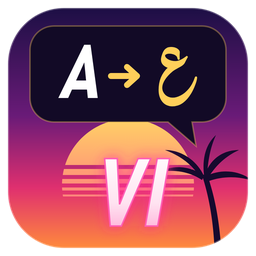

<p align="center">
  
</p>

<h1 align="center">VI Translator - Tizen</h1>

<p align="center">VI Translator's live subtitles on your Samsung TV, over the game from your console.</p>

---

## What it does

Shows VI Translator's translations on a Samsung Smart TV (Tizen, 2018 models and later), over the
game from your console on an HDMI input.

A Samsung TV lets no app draw over another input or app, so this app shows the console's HDMI
input itself, full screen, with the translations on top. Open the app instead of switching the TV
to the console's input. The app shows the picture only while it's open.

## How it works

1. The console goes into a capture card with passthrough, and the card's passthrough goes into the
   TV.
2. VI Translator on the PC reads the subtitles from the capture card and translates them.
3. This app shows the console's HDMI input and the translations over it, where they would be on
   the game picture. Only the text crosses your home network.

Or with the VI Translator phone app instead of the PC: the phone plays the PS5 or the Xbox over
Remote Play (no capture card) and reads the subtitles there, and this app shows the translations
on the TV the same way.

## Setup

1. **Install the app on the TV:** see *Install on a TV* below. It's not in the Samsung store.
2. **Open it:** it shows a 6-digit code.
3. **On the PC or the phone:** in VI Translator, *Show on* tab, *Connect a TV*. Type the code and
   press *Connect*. The TV finds the PC or phone by itself: it shows up in the list there within
   about 20 seconds.

Once connected, the app shows the console's input with the translations. Press **OK** on the remote
for the menu:

- **Input:** which HDMI input the app shows (the console's). At first, the input the TV was on when
  the app was opened, or the first one connected.
- **Language:** the app's language, the TV's own or one of VI Translator's 33. Also in the top
  corner of the code screen (press **OK** there).
- **Disconnect:** the TV forgets the PC (or phone) and shows a new code. Removing the TV in VI
  Translator on the PC or phone does the same.

**Back** closes the menu, or the app.

The app finds the PC or phone again if the router gives it a new address.

## Tips

- Set the console's input to *Game* in the TV's input settings if your TV offers it, and check the
  picture delay feels the same as on the input itself.
- The text style, the language and what is read are all set in VI Translator on the PC or phone.
- VI Translator on the PC or phone must use its default home-network port (8791) for the TV to find it.

## Connecting, for the PC side

A Tizen app can't be reached on the home network (it can't listen), so the TV looks for the PC
instead of the PC for the TV. While it shows a code, it asks every address of its /24 network on
port 8791, over and over (and the PCs that answered every 2 seconds):

```
POST /vit-tv/offer
X-VIT: 1
{"app":"vi-translator-tizen","id":"<this app's uuid>","name":"Samsung QE55Q60R","code":"482913"}
```

The PC answers **404** while nobody is connecting a TV there, **403** for a code other than the one
typed, **429** after too many wrong ones (the TV shows a new code), and **200**
`{"pc_name":"…","token":"<hex key>"}` when the code is the one typed in *Connect a TV*. From then
on it's the same as the Android TV app: `/tv?t=<key>`, `/tv.json`, a 403 when the TV was removed,
`/tv/forget` on Disconnect.

## Build

Needs [Tizen Studio](https://developer.samsung.com/smarttv/develop/getting-started/setting-up-sdk/installing-tv-sdk.html)
with the *TV Extensions* (Package Manager), and Node.js for the scripts.

1. **Certificate:** Tizen Studio, *Tools*, *Certificate Manager*, new *Samsung* certificate
   profile, type *TV*. You sign in with your Samsung account there. Add your TV's DUID (Device
   Manager shows it once the TV is connected) to the distributor certificate.
2. **Pack:**

   ```sh
   node tools/build.js <certificate profile>     # build/VITranslator.wgt
   ```

### Install on a TV

1. On the TV: *Apps*, type `12345` on the remote, turn *Developer mode* on, enter the PC's IP
   address, and restart the TV.
2. On the PC (`sdb` and `tizen` are in Tizen Studio's `tools` and `tools/ide/bin`):

   ```sh
   sdb connect <TV address>
   tizen install -n build/VITranslator.wgt -t <TV name from "sdb devices">
   ```

### Releases

Pushing a tag `vX.Y.Z` (newer than the latest release) builds `vi-translator-tizen-tv-X.Y.Z.wgt`
and attaches it to a GitHub release (`.github/workflows/release.yml`). It's signed with your
Samsung certificates, from four repository secrets:

| Secret | What |
| --- | --- |
| `TIZEN_AUTHOR_P12` | the author certificate, `author.p12`, in base64 |
| `TIZEN_AUTHOR_PASSWORD` | the password you gave it in Certificate Manager |
| `TIZEN_DISTRIBUTOR_P12` | the distributor certificate, `distributor.p12`, in base64 |
| `TIZEN_DISTRIBUTOR_PASSWORD` | the password you gave it in Certificate Manager |

1. **Make the certificates** as in *Build* above: Certificate Manager, new *Samsung* profile, type
   *TV*. You sign in with your Samsung account there, in Samsung's own window: that password is
   never needed anywhere else. The two passwords above are the ones you choose for the
   certificates in that wizard. The files end up in `~/SamsungCertificate/<profile name>/`.
2. **Add the secrets** (with the [GitHub CLI](https://cli.github.com/), from that folder):

   ```sh
   base64 -w0 author.p12 | gh secret set TIZEN_AUTHOR_P12 -R vi-translator/vi-translator-tizen-tv
   base64 -w0 distributor.p12 | gh secret set TIZEN_DISTRIBUTOR_P12 -R vi-translator/vi-translator-tizen-tv
   gh secret set TIZEN_AUTHOR_PASSWORD -R vi-translator/vi-translator-tizen-tv        # asks for it
   gh secret set TIZEN_DISTRIBUTOR_PASSWORD -R vi-translator/vi-translator-tizen-tv   # asks for it
   ```

   On Windows without `base64`, in PowerShell:
   `[Convert]::ToBase64String([IO.File]::ReadAllBytes("author.p12")) | gh secret set TIZEN_AUTHOR_P12 -R vi-translator/vi-translator-tizen-tv`.

A Samsung distributor certificate only lets the app on the TVs whose DUIDs it lists: a released
`.wgt` installs on those TVs. Anyone else builds it with their own certificate (*Build* above).

To try the release build on a computer with the Tizen Studio CLI, `tools/release.sh` does what the
workflow does (its header says how).

### Try it in a browser

```sh
node tools/mock-pc.js "" 18791
```

Then open `http://<this PC's address>:18791/index.html?pc=<this PC's address>:18791` (add
`&lang=ar` for another language). The mock stands in for VI Translator on the PC:
`/mock/connect?code=123456` types a code there, `/mock/remove` removes the TV. There's no HDMI
picture in a browser.

### Languages

The interface strings come from the Android TV app's (all 33 languages), plus the few only this
app has, in `tools/tizen-strings.json`:

```sh
node tools/import-strings.js <path to vi-translator-android-tv>    # js/strings.js
```

## Credits

The Changa font is under the SIL Open Font License (`FONT-LICENSE-Changa.txt`).
